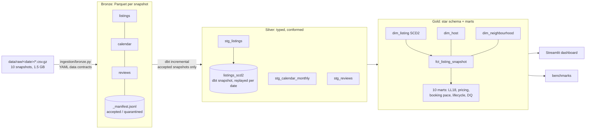
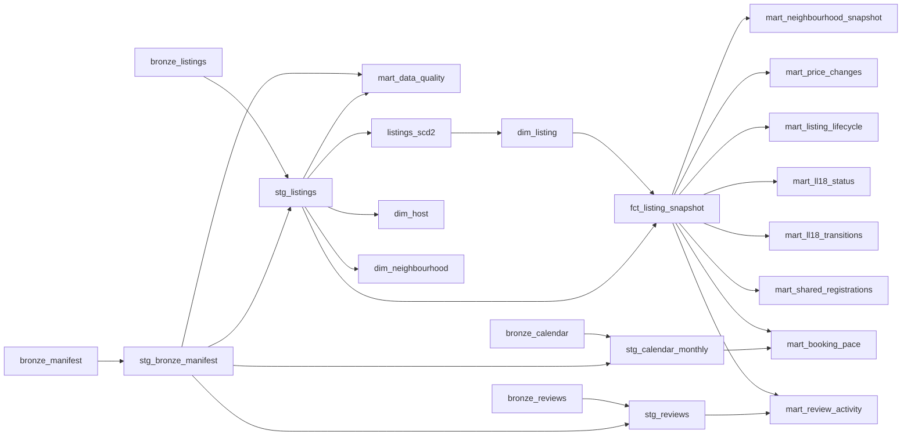

# NYC Airbnb Warehouse

A production-style analytics engineering platform over ten [Inside Airbnb](https://insideairbnb.com/get-the-data/) snapshots of New York City (March to November 2026). It is built with Python, DuckDB and dbt, and the dbt project is written to run on Snowflake as well.

The standout feature is the **Local Law 18 radar**. Since 2023, NYC has required hosts who offer stays under 30 nights to register with the city. The radar tracks, snapshot by snapshot, which listings show a registration, which claim an exemption, which moved to 30+ night minimums, and which still accept short stays with neither. It also flags registration numbers reused across listings and hosts.



## Run it

```bash
uv sync                                   # Python 3.12, dbt-core 1.12, dbt-duckdb, DuckDB 2.0
uv run python pipeline.py                 # incremental: bronze -> silver -> SCD2 replay -> gold -> tests
uv run python pipeline.py --full-refresh  # rebuild silver/gold and replay SCD2 from the first snapshot
uv run streamlit run dashboard/app.py     # dashboard on localhost
uv run pytest -q                          # contract unit tests + end-to-end on synthetic data + dashboard smoke test
uv run python benchmarks/run.py           # regenerate docs/benchmarks.md
```

Raw files go in `data/raw/<snapshot-date>/{listings,calendar,reviews}.csv.gz`. The `data/` folder is git-ignored.

## What happens on a run

| Step | What it does | Measured on this data |
|---|---|---|
| Bronze | Hashes each raw file and skips any whose file hash and contract hash are both unchanged. Checks the rest against its YAML contract and writes Parquet. Files that fail are **quarantined**: they are kept in bronze but never read downstream. | First load: 4 min 5 s. Rerun with nothing new: skips every file. |
| Silver | dbt incremental models that load each *accepted* snapshot they don't already hold. They key on snapshot identity rather than a high-water mark, so a late, older snapshot still loads. | ~2 s |
| SCD2 | `dbt snapshot` is replayed once per pending snapshot date, oldest first. SCD2 boundaries land on the real snapshot date, not the wall-clock time of the run. | ~4 s per snapshot |
| Gold + tests | Builds the facts, dimensions and marts, then runs every dbt test. Test results are appended to `data/quality/test_history.jsonl`. | ~5 s |

The full pipeline takes **12–13 s** when nothing is new (mostly re-hashing 1.5 GB of raw files) and **52 s** for a full refresh.

## Architecture decisions

- **DuckDB locally, Snowflake-ready.** Everything runs on a laptop at no cost. Two macros, `parse_money` and `array_length`, use `adapter.dispatch` for the places where DuckDB and Snowflake SQL differ, and date arithmetic uses dbt's cross-database macros. Bronze is a schema of views locally and a schema of tables on Snowflake, so the dbt sources are identical. See [docs/snowflake.md](docs/snowflake.md); that path has not been run yet.
- **Contracts gate at the file, tests guard the model.** Contracts block a file only for problems that make the whole snapshot untrustworthy: a missing column, an unparseable type, a broken primary key, or a volume collapse. Row-level gaps, such as 30 null `minimum_nights` values, are dbt tests at `warn` severity. My first contract mixed the two and rejected 8 good snapshots over 2–8 null values each. Changing a contract re-validates only the files of that dataset.
- **SCD2 through dbt snapshots, replayed in order.** A dbt snapshot normally records history as of the moment it runs. To rebuild history from archived snapshots, the pipeline passes each snapshot date as a variable, and `snapshot_get_time()` is overridden to return that date. Hard deletes are on, so a listing that disappears is closed on the first snapshot it is missing from, and it opens a new version if it returns. The test `tests/assert_scd2_reconciles_with_silver.sql` proves the history reproduces every silver snapshot exactly.
- **Price is a measure, not an attribute.** I checked the data: Inside Airbnb's `price` equals the nightly rate of one *quoted stay*, and that stay's check-in date and length (mostly 30 nights, sometimes 1–3) vary per listing. Tracking price in SCD2 produced 191,969 versions, most of them quote noise. Price now lives in the periodic snapshot fact, and comparisons are like-for-like on quote length. The result is **56,657 versions for 41,760 listings**.
- **Unreliable source fields are carried, not tracked.** `beds` completeness swings from 58% to 11% to 0% to 69% between scrapes. Tracking it would create false SCD2 versions, so `beds` and `bedrooms` are kept as columns but excluded from change tracking.
- **Data minimisation.** Reviewer names and review text are dropped at bronze. They are personal data and nothing downstream uses them.

## Data contracts caught real problems

| File | Contract result | Why |
|---|---|---|
| 2026-06-08 listings / calendar / reviews | quarantined | Partial extract: 4,506 listings, 99.7% of them registered or exempt, against ~30k in neighbouring snapshots (84% volume drop). Without the gate, SCD2 would have "deleted" ~25k listings and revived them 6 days later. |
| 2026-10-04 reviews | quarantined | 24,244 duplicate review IDs (7,784 IDs, each mapped to conflicting listings, dates or reviewers). The review log is cumulative, so the 2026-11-01 file covers the same reviews. |

26 of 30 files were accepted, and 3,135,649 rows were quarantined.

## Tests

- **dbt:** 50 data tests and 1 unit test. They cover keys, relationships, accepted values and ranges; SCD2 range integrity (a custom generic test); reconciliation of SCD2 against silver; quarantine exclusion; and a unit test of money parsing, license normalisation and Local Law 18 classification.
- **pytest (13 tests):** contract logic, plus an end-to-end run on synthetic snapshots (`tests/synthetic.py`). The synthetic data includes a partial snapshot that must be quarantined, an attribute change, a listing that disappears and returns, a lower-case registration number, and a listing that drops to a short-term minimum. The second pipeline run in that test must be a no-op. A dashboard smoke test renders every tab.
- **CI** (`.github/workflows/ci.yml`): ruff lint and format checks, pytest, and dbt docs (lineage) uploaded as a build artifact.

## Findings (verified against the warehouse)

These figures are from the 2026-11-01 snapshot unless noted.

- **80% of NYC listings (24,012 of 29,873) set a 30+ night minimum,** which puts them outside the short-term registration rule. 2,283 show a registration and 2,784 claim an exemption.
- **Unregistered short-term listings more than doubled, from 367 (Jun 14) to 794 (Nov 1).** 680 of them are in Manhattan, and Midtown alone has 239. This is a *risk signal*: the data shows what hosts display on Airbnb and is not matched against the city's registry.
- **253 registration numbers appear on more than one listing (564 listings in total).** A registration covers one dwelling unit, so this reuse is worth a closer look. In 4 cases the same number appears across different hosts.
- **Booking pace:** the share of October 2026 nights still open was 56% at the May 14 snapshot and fell to 26% by October 4.
- **Supply churn:** the May 14 snapshot dropped 6,448 listings that had been present in April.

## Benchmarks

Measured on an Apple M4 Pro; the full table is in [docs/benchmarks.md](docs/benchmarks.md).

- Median price by borough per snapshot: raw CSV 1.25 s, bronze Parquet 0.009 s, gold mart 0.0007 s.
- Point-in-time lookup of listing attributes, with the same columns on both sides: bronze 0.061 s against SCD2 0.032 s (2×).
- Bronze Parquet is 102 MB for listings (152 MB raw gzip) and 17 MB for calendar (240 MB raw gzip).

## Lineage

Generated from the dbt manifest. Run `dbt docs generate` for the interactive version.



## Layout

```
ingestion/            contracts/*.yml, contract.py (pure rules), bronze.py (I/O)
transform/            dbt project: models/silver, snapshots, models/gold/{core,marts}, macros, tests
pipeline.py           orchestration (bronze -> silver -> SCD2 replay -> gold -> tests)
dashboard/            Streamlit app (app.py) and read-only gold queries (queries.py)
benchmarks/run.py     reproducible timings -> docs/benchmarks.md
tests/                contract unit tests, synthetic data generator, end-to-end and dashboard tests
```

## Limits and next steps

- Snowflake and AWS are not provisioned. The loading runbook is written ([docs/snowflake.md](docs/snowflake.md)) but has not been run.
- The calendar shows a night as unavailable without saying whether it was booked or blocked, so booking pace is an upper bound on bookings.
- Late-arriving *older* snapshots load into silver but need `--full-refresh` to slot into the SCD2 history; the reconciliation test flags any mismatch until then.

Data: Inside Airbnb, licensed under CC BY 4.0.
