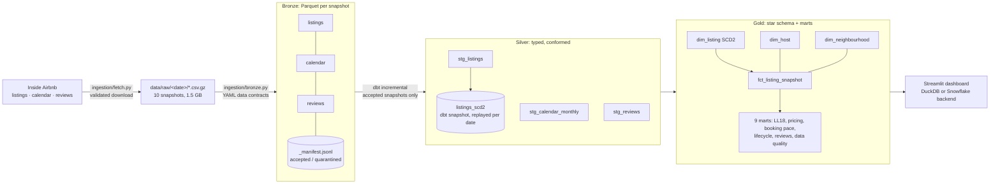
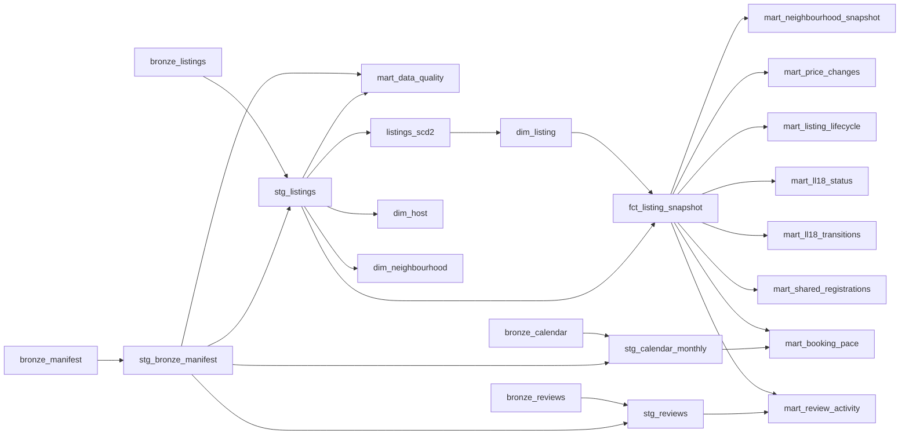

# NYC Airbnb Analytics Warehouse

A local, end-to-end analytics warehouse built on ten [Inside Airbnb](https://insideairbnb.com/get-the-data/)
snapshots of New York City (March to November 2026). Raw CSV extracts pass through contract-checked
ingestion, a dbt-modelled Bronze → Silver → Gold medallion architecture with SCD Type 2 history, and a
Streamlit dashboard. Everything runs on a laptop on DuckDB, at no cost. The dbt project and dashboard
are prepared for Snowflake, which has not yet been deployed.

## 1. Project overview

Inside Airbnb publishes each city as a series of independent snapshots. Each snapshot describes the market
on one day, but none of them records what changed between days. This project turns those snapshots into a
history-aware warehouse that can answer questions no single file can:

- **Regulatory exposure (NYC Local Law 18).** Since 2023, hosts offering stays under 30 nights must register
  with the city. The warehouse classifies every listing in every snapshot as registered, exempt, 30+ night
  minimum, or unregistered short-term. It tracks movement between those states and flags registration
  numbers reused across listings and hosts.
- **Pricing and availability over time,** compared like-for-like on quoted stay length.
- **Forward booking pace:** how fast future nights close, from the 365-day availability calendar.
- **Supply churn:** listings that appear, disappear and return, from the SCD2 history.
- **Review activity** as a long-run demand proxy (2009 onward, from the cumulative review log).

It was built to demonstrate analytics-engineering practice on real, imperfect data: incremental loads, data
contracts that quarantine bad files, reproducible slowly-changing dimensions, tested dbt models, and
portability to a cloud warehouse.

## 2. Architecture



| Layer | Storage | Built by | Contents |
|---|---|---|---|
| Raw | `data/raw/<date>/*.csv.gz` | `ingestion/fetch.py`, or placed by hand | Source files, unchanged |
| Bronze | Parquet per dataset and snapshot, exposed as DuckDB views | `ingestion/bronze.py` | Every source column as text, plus lineage columns (`_snapshot_date`, `_source_file`, `_file_sha256`, `_ingested_at`). A manifest records each file's contract result |
| Silver | DuckDB (`silver` schema) | dbt incremental models, dbt snapshot | Typed, cleaned staging models from accepted snapshots only; `listings_scd2` |
| Gold | DuckDB (`gold` schema) | dbt tables | `dim_listing` (SCD2), `dim_host`, `dim_neighbourhood`, `fct_listing_snapshot` and 9 marts |

`pipeline.py` runs everything in order: bronze, then silver, then the SCD2 replay one snapshot at a time,
then gold, then every dbt test. dbt lineage, generated from the manifest:



## 3. Tech stack

| Status | Technology | Role |
|---|---|---|
| **Working locally** | Python 3.12, [uv](https://docs.astral.sh/uv/) | Runtime and locked dependency management (`uv.lock`) |
| | DuckDB 2.0 | Local warehouse and bronze query engine |
| | dbt-core 1.12 + dbt-duckdb, dbt_utils | Silver/gold models, SCD2 snapshot, data and unit tests |
| | Parquet (zstd) via DuckDB, PyArrow | Bronze storage |
| | YAML data contracts (`ingestion/contracts/`) | File-level validation and quarantine |
| | Streamlit, Plotly, pandas | Dashboard |
| | pytest, ruff | Tests, lint and format |
| **Configured, not deployed** | Snowflake: dbt-snowflake, snowflake-connector-python (optional `snowflake` extra) | Alternate dbt target and dashboard backend; setup and load scripts in `deploy/snowflake/` |
| | GitHub Actions (`.github/workflows/ci.yml`) | Workflow is defined but **not currently running** on the repository (see [Testing](#7-testing-and-validation)) |
| **Optional** | launchd or cron | Local scheduling of snapshot downloads; documented in [docs/ingestion.md](docs/ingestion.md), not installed |

## 4. Data engineering features

**Incremental ingestion.** Bronze hashes each raw file and skips any whose file hash *and* contract hash are
both unchanged, so a rerun with nothing new does no ingestion work. Changing a contract re-validates only that
dataset's files. Silver models are dbt incrementals keyed on snapshot identity rather than a high-water mark,
so a late-arriving older snapshot still loads. The manifest is rewritten atomically after each file, so
progress survives a crash.

**SCD Type 2 history.** `listings_scd2` is a dbt snapshot (check strategy, hard deletes invalidated), replayed
one snapshot date at a time, oldest first. `snapshot_get_time()` is overridden so version boundaries land on
the real snapshot date rather than the time of the run. A listing that disappears is closed on the first
snapshot it is missing from, and opens a new version if it returns. A custom generic test
(`scd2_valid_ranges`) checks that versions never overlap. A singular test
([`assert_scd2_reconciles_with_silver.sql`](transform/tests/assert_scd2_reconciles_with_silver.sql)) proves
the history reproduces every silver snapshot exactly.

**dbt transformations.** Silver types and conforms the text-only bronze columns: it parses money, percentages
and booleans, normalises license strings, and rolls the calendar up to monthly grain. Gold is a star schema
(`fct_listing_snapshot` as a periodic snapshot fact, with listing, host and neighbourhood dimensions) plus
9 marts. Engine-specific SQL is isolated in macros that use `adapter.dispatch`, and date arithmetic uses
dbt's cross-database macros.

**Data contracts.** One YAML contract per dataset declares required columns and types, not-null keys,
accepted values, the primary key, a minimum row count, and a maximum volume drop against the previous accepted
snapshot. A failing file is **quarantined**: it is kept in bronze for audit but never read downstream.
Contracts block only problems that make a whole snapshot untrustworthy. Row-level gaps are dbt tests at
`warn` severity.

**Data quality validation.** dbt data tests cover keys, relationships, accepted values and ranges, plus
SCD2 integrity, quarantine exclusion and a unit test of the parsing and classification logic. Each run's test
results are appended to `data/quality/test_history.jsonl`, and the dashboard's Data quality tab reads them
alongside `mart_data_quality`.

**Automated snapshot downloading.** [`ingestion/fetch.py`](ingestion/fetch.py) (standard library only)
discovers new snapshots or takes `--date`. It validates the source (https only, a host allowlist, the exact
path pattern, no future dates). It verifies Content-Length, decompresses every file in full to check gzip
integrity, and checks the CSV header against the contract. It rejects files byte-identical to ones already
landed and lands each snapshot all-or-nothing with an atomic rename. Transient failures are retried with
backoff, a file lock prevents concurrent runs, and every step is logged to a JSONL audit file. Details are in
[docs/ingestion.md](docs/ingestion.md).

**DuckDB warehouse.** One file (`data/warehouse.duckdb`) holds the silver and gold schemas. Bronze is a
schema of views over Parquet. The dashboard opens the file read-only for each query, so it never holds the
lock while the pipeline writes.

**Snowflake preparation.** A `snowflake` profile target, an optional dependency group, setup and
cost-guardrail SQL, a bronze load-script renderer, post-load reconciliation, and a dashboard backend
switch. An offline test parses the whole dbt project with the Snowflake adapter and lints the models for
DuckDB-only SQL and Snowflake reserved words. See [section 9](#9-snowflake-deployment).

## 5. Dataset and scale

Measured on this project's data; sources are this README's earlier revisions and
[docs/benchmarks.md](docs/benchmarks.md).

| Measure | Value |
|---|---|
| Snapshots | 10 (2026-03-16 to 2026-11-01), 3 datasets each = 30 files |
| Raw size (gzip CSV) | ~1.5 GB: listings 152 MB, calendar 240 MB, reviews 1,130 MB |
| Bronze size (Parquet, zstd) | listings 102 MB, calendar 17 MB, reviews 147 MB (reviewer names and text dropped) |
| DuckDB warehouse (silver + gold) | 207 MB |
| Contract outcome | 26 of 30 files accepted; 3,135,649 rows quarantined |
| Active listings, latest snapshot | 29,873 |
| SCD2 history | 56,657 versions for 41,760 listings |
| Review history | 210 months (May 2009 to Nov 2026) |

**Pipeline timings (local).** First bronze load: 4 min 5 s. Full refresh of silver, SCD2 and gold: 52 s.
Incremental run with nothing new: 12–13 s, mostly spent re-hashing the raw files.

**Query benchmarks** (12-core ARM laptop, DuckDB 2.0, median of 5 runs; full table in
[docs/benchmarks.md](docs/benchmarks.md)):

| Question | Raw CSV | Bronze Parquet | Gold |
|---|---:|---:|---:|
| Median price by borough per snapshot | 1.25 s | 0.009 s | 0.0007 s (mart) |
| Unregistered short-term listings per snapshot | 1.25 s | 0.003 s | 0.0006 s (mart) |
| Point-in-time listing attributes as of 2026-07-01 | n/a | 0.061 s | 0.032 s (SCD2) |

Gold marts are pre-aggregated, so part of their speed-up is work done once at build time.

**What the contracts caught:**

| File | Result | Why |
|---|---|---|
| 2026-06-08 listings, calendar, reviews | quarantined | A partial extract: 4,506 listings against ~30k in neighbouring snapshots (an 84% volume drop). Without the gate, SCD2 would have closed ~25k listings and reopened them 6 days later. |
| 2026-10-04 reviews | quarantined | 24,244 duplicate review IDs, with conflicting listings, dates or reviewers. The cumulative 2026-11-01 file covers the same reviews. |

## 6. Analytics dashboard

`dashboard/app.py` (Streamlit) reads only the gold layer (plus `silver.stg_listings` for map coordinates).
A snapshot slider applies across tabs, and the header names the active warehouse backend.

| Tab | Business question |
|---|---|
| Overview | How large is the market, and what are the median 30-night rate, short-term share and 30-day availability? How are these trending by borough? |
| Neighbourhoods | Which neighbourhoods are growing, more expensive or more short-term heavy? What is each one's price and review-activity history? |
| Local Law 18 radar | How is registration status changing, which listings moved between states, where are unregistered short-term listings concentrated (table and map), and which registration numbers are shared? |
| Booking pace | For each future month, how quickly do open nights close as the stay date approaches? |
| Listing history | What exactly changed for one listing, version by version (SCD2), alongside its price and availability per snapshot? |
| Data quality | Which files were accepted or quarantined and why, and how have dbt test results changed over runs? |

Findings from the 2026-11-01 snapshot, verified against the warehouse:

- 80% of listings (24,012 of 29,873) set a 30+ night minimum, which puts them outside the registration rule.
- Unregistered short-term listings rose from 367 (2026-06-14) to 794 (2026-11-01); 680 of them are in Manhattan.
  This is a risk signal based on what hosts display, not a match against the city's registry.
- 253 registration numbers appear on more than one listing (564 listings in total).
- The share of October 2026 nights still open fell from 56% (May 14 snapshot) to 26% (October 4). This is an
  upper bound on bookings, because the calendar does not distinguish booked nights from blocked ones.

## 7. Testing and validation

| Check | Result |
|---|---|
| `uv run pytest -q` (Python) | **87 passed, 1 skipped** (the Snowflake compatibility check needs `uv sync --extra snowflake`; with it, 88 pass): contract logic; an end-to-end pipeline run on synthetic snapshots (quarantine, SCD2 change/close/reopen, LL18 transitions, idempotent second run); dashboard smoke test; DuckDB/Snowflake backend selection; offline Snowflake compatibility; the downloader against a local HTTP server with injected faults |
| `dbt build` on the real 10-snapshot warehouse | **65 passed, 1 warning, 0 errors** |
| `ruff check` and `ruff format --check` | Clean |
| Dashboard on real data | Renders every tab without exceptions |

The single warning is a known, intentional `warn`-severity test: 30 listings have a null `minimum_nights`.
It is a row-level gap, not a reason to reject the snapshot.

**CI status:** GitHub Actions (`.github/workflows/ci.yml`: install, lint, pytest, dbt docs artifact) runs on
every push to `main` and on pull requests. It was registered when the workflow first reached `main`
(2026-11-19), so the first six pull requests were merged on local results; every push to `main` since has run
CI, and the latest run passed all steps. There is no deployment (CD) step: Snowflake is not deployed.

## 8. Local setup

Requires [uv](https://docs.astral.sh/uv/getting-started/installation/). uv installs Python 3.12 if needed.

```bash
uv sync                                   # install locked dependencies
uv run python -m ingestion.fetch --dry-run  # see which new snapshots are available (downloads nothing)
uv run python -m ingestion.fetch          # download new snapshots into data/raw/<date>/
uv run python pipeline.py                 # incremental: bronze -> silver -> SCD2 replay -> gold -> tests
uv run python pipeline.py --full-refresh  # rebuild silver/gold and replay SCD2 from the first snapshot
uv run streamlit run dashboard/app.py     # dashboard at http://localhost:8501
uv run pytest -q                          # full test suite (builds its own synthetic warehouse)
uv run python benchmarks/run.py           # regenerate docs/benchmarks.md
```

Raw files can also be placed by hand in `data/raw/<YYYY-MM-DD>/{listings,calendar,reviews}.csv.gz`.
The Inside Airbnb index lists only the latest NYC snapshot, so earlier dates need `--date YYYY-MM-DD`.
`data/` is git-ignored.

## 9. Snowflake deployment

**Status: prepared, not deployed.** No Snowflake account has been used, and no objects or costs have been
created. The step-by-step runbook is [docs/snowflake.md](docs/snowflake.md). In outline:

1. `uv sync --extra snowflake` and set credentials in the environment (key-pair auth; nothing is committed).
2. Apply cost guardrails and setup: [`deploy/snowflake/00_cost_guardrails.sql`](deploy/snowflake/00_cost_guardrails.sql)
   (a resource monitor with a 5-credit monthly cap) and [`01_setup.sql`](deploy/snowflake/01_setup.sql)
   (an XS warehouse with 60 s auto-suspend, schemas, and `TRANSFORMER`/`REPORTER` roles).
3. Build bronze locally, then load it with the script generated by
   [`deploy/snowflake/render_load.py`](deploy/snowflake/render_load.py), which is idempotent per snapshot.
4. Reconcile row counts with [`03_verify_bronze.sql`](deploy/snowflake/03_verify_bronze.sql).
5. `DBT_TARGET=snowflake uv run python pipeline.py --skip-bronze` runs the same models and tests on Snowflake.
6. `AIRBNB_WAREHOUSE_BACKEND=snowflake uv run streamlit run dashboard/app.py`.

The readiness audit found and fixed three issues before any deployment: snapshots overwriting each other
in a single stage prefix, case-sensitive inferred column names, and a column named with the reserved word
`rows`. `dbt compile` and `dbt build` against Snowflake, and real COPY behavior, can only be verified with an account.

## 10. Engineering decisions

- **Medallion architecture.** Each layer has one job. Bronze preserves the source with full fidelity and
  lineage, so any downstream result can be rebuilt or audited. Silver is the single place types and
  cleaning rules live. Gold is shaped for questions. Quarantined data stays inspectable in bronze without
  ever reaching consumers.
- **Incremental processing.** Snapshots arrive about monthly, and reprocessing 1.5 GB to add one is wasteful.
  Keying increments on file hash and snapshot identity, rather than timestamps, makes reruns no-ops and
  handles late or re-delivered files correctly.
- **SCD Type 2 via replayed dbt snapshots.** Point-in-time questions ("what did this listing look like in
  July?") need versioned attributes. Replaying each archived snapshot with its own date as the effective
  time produces the history that would have been recorded had the warehouse existed all along. A
  reconciliation test makes the replay verifiable.
- **Price as a measure, not an SCD2 attribute.** Inside Airbnb's `price` is the nightly rate of one quoted
  stay, whose dates and length vary per listing. Tracking it in SCD2 produced 191,969 versions, mostly quote
  noise. Price now lives in the snapshot fact and is compared on matching quote lengths. Fields that the
  source fills inconsistently between scrapes (`beds`, `bedrooms`) are carried but not tracked.
- **Data contracts at the file boundary.** A partial or corrupt extract should stop at the door, not
  silently close 25,000 SCD2 records. Contracts are deliberately narrow: an early version that also blocked
  on row-level nulls rejected 8 good snapshots, so row-level rules moved to dbt warn-tests.
- **dbt.** It provides dependency-ordered builds, incremental materialisations, snapshots, tests and lineage
  documentation from SQL under version control. Its adapter abstraction is what lets the same project target
  DuckDB today and Snowflake later.
- **Data minimisation.** Reviewer names and review text are dropped at bronze; nothing downstream needs them.

## 11. Project status

| Area | Status |
|---|---|
| Bronze/Silver/Gold pipeline, SCD2, data contracts, dbt tests | Complete, running locally on real data |
| Automated snapshot download | Complete; run manually (scheduling documented, not installed) |
| Dashboard (DuckDB backend) | Complete |
| Snowflake: dbt target, setup, load and reconciliation scripts, dashboard backend | Prepared and checked offline; **not deployed** |
| GitHub Actions CI | Running on pushes to `main` (latest: passing); pull-request runs apply from the next PR on |

## 12. Future improvements

- Deploy to a Snowflake trial account behind the resource monitor, then run the reconciliation and full dbt test suite there.
- Protect `main` with required CI checks so pull requests cannot merge red.
- Handle a late-arriving *older* snapshot in SCD2 without a full refresh (today the reconciliation test flags it until `--full-refresh` runs).
- Detect schema drift in Snowflake landing tables (they are templated from the oldest snapshot).

## Repository layout

```
ingestion/          contracts/*.yml, contract.py (rules), bronze.py (ingestion), fetch.py (downloader)
transform/          dbt project: models/silver, snapshots, models/gold/{core,marts}, macros, tests
pipeline.py         orchestration: bronze -> silver -> SCD2 replay -> gold -> tests
dashboard/          app.py (Streamlit), queries.py (gold queries), backends.py (DuckDB / Snowflake)
deploy/snowflake/   cost guardrails, setup, bronze load renderer, reconciliation, teardown (not yet run)
benchmarks/         run.py -> docs/benchmarks.md
docs/               benchmarks.md, ingestion.md, snowflake.md
tests/              pytest suite and synthetic data generator
```

Data: Inside Airbnb, licensed under CC BY 4.0.
